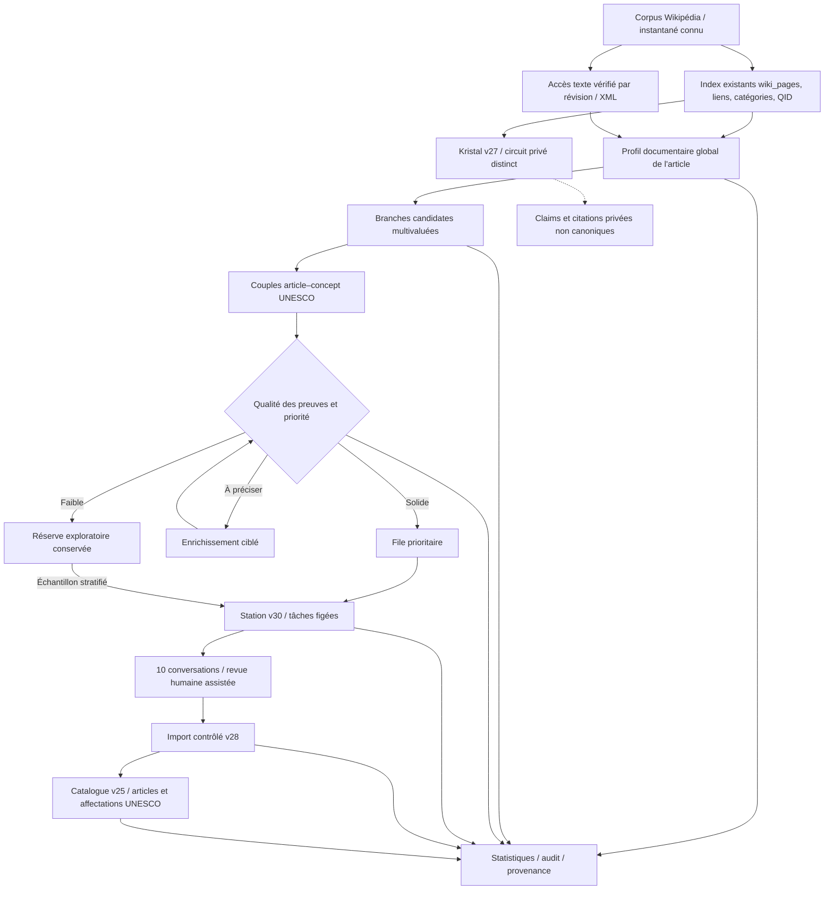

# EncyKlopedia — Architecture fonctionnelle et technique cible

**Référence documentaire :** ENC-ARCH-V31, révision 1, 13 novembre 2026  
**Statut :** **spécification cible approuvable**, **non codée / non déployée**  
**Système actuel préservé :** catalogue UNESCO × Wikipédia v25, inventaire de catégories v26, Kristal privé v27, découverte UNESCO v28, station ChatGPT v30.  
**Règle :** ce document décrit le système final visé ; il ne constitue pas une attestation que chaque composant existe déjà.

## 1. Décision architecturale

EncyKlopedia doit devenir un **système d'inventaire, de qualification multibranche et de validation documentaire** qui exploite les index massifs existants au lieu de reconstruire Wikipédia ou de dupliquer le catalogue. L'inventaire reste exhaustif à l'échelle des articles de l'instantané retenu ; aucun véritable article n'est éliminé parce qu'il paraît hors du champ d'une branche. Une association article–branche ou article–concept peut être différée, corrigée ou enrichie ; elle ne doit pas être confondue avec un rejet d'article.

La **station v30 demeure l'unique émettrice de tâches** et la seule responsable du scellement de leurs preuves. Le catalogue existant demeure le registre des affectations UNESCO approuvées. **Kristal v27 reste privé, provisoire et non canonique**. Les nouveaux traitements fonctionnent initialement en *observation*, sur les candidats libres et non sur les tâches déjà distribuées.

**Principe déterminant : inventaire ≠ profil de page ≠ affectation à une branche ≠ candidat de concept ≠ décision de revue ≠ admission canonique.** Chaque état répond à une question distincte et possède sa propre provenance.

## 2. Finalité et périmètre

### 2.1 Objectifs

1. Pouvoir **retrouver chaque article encyclopédique** du corpus Wikipédia retenu, avec son identité et sa révision d'origine, sans l'envoyer individuellement à ChatGPT.
2. Préqualifier une page **une seule fois par révision**, puis réutiliser ce profil dans plusieurs domaines et branches.
3. Déduire **plusieurs branches plausibles par page**, sans forcer un classement unique ; raffiner ensuite en concepts UNESCO précis à l'aide des libellés, relations et notes de portée.
4. Réduire la proportion de rapprochements accessoires envoyés en revue, tout en **conservant et en auditant** les découvertes inattendues.
5. Produire des **preuves vérifiables**, idéalement des extraits rattachés à une révision ; ne jamais inventer de passage ni contourner une incompatibilité de signature XML.
6. Conserver le cycle de **dix conversations parallèles** avec des ZIP de revue compatibles, des identifiants inaltérables et des imports idempotents.
7. Fournir des **statistiques globales et par branche** dont les dénominateurs et limites sont explicites.
8. Autoriser des packs de taille adaptative **après** validation de leur intégration native (110 en repli ; essais 150–200, puis 300).

### 2.2 Non-objectifs

- Construire immédiatement une nouvelle base contenant les millions de pages et tous leurs liens.
- Déclarer que toute page possède un concept UNESCO exact, ou qu'elle ne vaut rien si aucun concept n'est trouvé.
- Transformer une faible priorité en `REJECT`, ou un `APPROVE` documentaire en admission canonique / publication.
- Remplacer les bases historiques, réparer l'index XML en contournant les contrôles, ou modifier les tâches en cours.
- Considérer un score, une catégorie ou une similarité sémantique comme preuve suffisante de correspondance substantielle.

## 3. Architecture réutilisant les couches existantes

**Important :** les nœuds « profil », « branches candidates », « réserve » et « statistiques unifiées » représentent des **fonctions cibles**, qui pourront être hébergées dans des structures existantes ou dans une petite base auxiliaire après audit des scripts. Le dessin ne prescrit pas de nouvelle base massive.

## 4. Granularités et identité

| Niveau | Rôle | Source identifiée | Fiabilité aujourd'hui |
|---|---|---|---|
| Instantané / révision | Empêcher le mélange de versions | `wiki_pages.latest_revision`, index direct `revision_id`, dump XML | Schémas présents ; cohérence inter-sources à prouver |
| Page | Identité stable (`wiki`, `page_id`) | `wiki_pages`, index direct, `articles` | Confirmé au schéma |
| Alias / redirection | Résoudre sans perdre le lien d'origine | `wiki_pages.redirect`, direct index `is_redirect` | Signal présent ; contrat de résolution à vérifier |
| Liens de page à page | Découvrir le voisinage documentaire | `wiki_pagelinks` + `wiki_linktargets` | Confirmé au schéma, jointures à valider |
| Catégorie / hiérarchie | Rappels de domaine, connexions indirectes | `wiki_categorylinks`, `wiki_categorylink_ids`, v26 | Confirmé au schéma, faux positifs nombreux |
| QID | Enrichissement et rapprochements d'identité | `wiki_qid`, Wikidata | Table confirmée, couverture à mesurer |
| Section / passage | Preuve localisée utile à une relation | Citations Kristal `section_hint`, `source_quote` | Confirmé sur claims privés ; pas d'index global prouvé |
| Paragraphe / phrase / position d'un lien | Explication fine | **Aucun index universel confirmé** | Option future, si nécessaire |
| Branche / concept | Taxonomie et rattachement | `branches`, `branch_concepts`, `concepts`, `assignments` | Confirmé dans catalogue v25 |
| Décision | Validation propre à une paire | `reviewed_article_links_v28` | Confirmé au schéma |

La clé d'identité principale est `(wiki, page_id)`. Le `title` peut changer ; le QID enrichit l'identité mais ne remplace pas une clé locale. Les artefacts de contenu/profil sont liés au **snapshot et à la révision**. La clé d'un concept est `(vocabulary, concept_id)` ; la branche conserve son `branch_id` natif. Une preuve a sa propre provenance et empreinte.

**Piège critique :** `wiki_pagelinks.target_id` n'est pas `wiki_pages.page_id`. La résolution passe par `wiki_linktargets(target_id, ns, title)` puis par une stratégie explicite de recherche de page, espace de noms et redirections, à valider sur des cas réels.

## 5. Pipeline cible de bout en bout

### 5.1 Recensement global, sans exclusion

- Choisir un corpus d'articles Wikipédia à un **instantané explicite**. Pour le taux de couverture encyclopédique, compter les pages de l'espace de noms principal (`ns=0`) et distinguer pages ordinaires, redirections, homonymies et listes. Le nombre de 25 932 219 entrées de l'index direct comprend d'autres espaces de noms : il **ne correspond pas** au nombre d'articles encyclopédiques.
- Réutiliser `wiki_pages` ou l'index direct comme registre maître **si** couverture, ingestion et cohérence ont été validées ; ne pas créer un double stock de titres/textes.
- Une redirection reste dans l'inventaire comme alias vers une cible résolue, avec historique de provenance. Une homonymie reste une page distincte mais n'est pas forcément affectable comme un thème simple.
- Les pages sans branche demeurent `NON_CLASSE`, `A_PRECISER` ou `A_REVISITER` ; aucune suppression ni exclusion irréversible.

### 5.2 Profil documentaire global

Pour chaque page et révision, synthétiser des **indices**, non des décisions : type (lieu, personne, organisme, loi, événement, méthode, ouvrage, technologie...), thèmes, catégories pertinentes, liens proches, QID si disponible, langue, bref extrait vérifié si accessible, date/source et degré de fiabilité.

Le profil peut être obtenu par règles déterministes, données structurées et enrichissement textuel ciblé. Les catégories génériques, administratives et géographiques reçoivent une valeur informative faible. Aucune supposition de section, de passage ou de citation en l'absence d'une source authentifiée.

### 5.3 Classement multibranche

À partir du profil, proposer **zéro, une ou plusieurs branches** avec un score explicable et une justification brève. Un même article peut légitimement participer à plusieurs branches sans être copié. L'absence de branche est un état normal, pas un échec ni un `REJECT`.

L'organisation UNESCO et les hiérarchies officielles restent l'autorité pour les concepts. Les grandes étiquettes de domaine peuvent aider l'orientation, mais ne doivent pas être confondues avec les identifiants exacts de branches enregistrés par EncyKlopedia. Si des branches futures utilisent d'autres vocabulaires que l'UNESCO, leurs identifiants doivent être explicitement nommés et séparés par `vocabulary` ; leur prise en charge par le code v25 doit être vérifiée avant activation.

### 5.4 Qualification article–concept

Pour chaque `(page_id, vocabulary, concept_id, branch_id)`, comparer les libellés, notes de portée et relations hiérarchiques aux **preuves propres à l'article**. Distinguer correspondance substantielle, simple mention, proximité de catégorie, analogie générique et lien géographique/administratif.

Le moteur produit un **score de tri et des raisons auditables**, **pas** `APPROVE/REJECT/HOLD`. Ces trois décisions appartiennent à la revue v28 et aux contrats actuels d'import.

### 5.5 Enrichissement ciblé

Prioriser l'acquisition d'extraits lorsqu'ils pourraient changer une décision. Vérifier `page_id`, révision, provenance et empreinte du dump/du contenu avant de citer un passage.

L'incompatibilité observée entre le dump XML et l'index direct v21 doit rester un **verrou de sécurité** tant que la correspondance des offsets n'a pas été prouvée. Privilégier la récupération ciblée par page ou un index auxiliaire minimal ; reconstruire un index massif seulement si un audit démontre que c'est nécessaire et rentable.

### 5.6 Constitution et distribution des packs

La station v30 est le **seul ordonnanceur**. Le classement s'applique **avant** la création d'une tâche à des candidats libres, sans modifier `candidate_id` ou `evidence_sha256`. Une fois émise, une tâche garde son CSV, ses preuves, ses empreintes et ses contrats jusqu'à l'import.

Trois files de sélection : `PRIORITAIRE`, `A_ENRICHIR`, `EXPLORATION_DIFFEREE`. La troisième conserve les candidats et alimente un **échantillon représentatif stratifié** ; elle n'est pas un ensemble de rejets. Des quotas assurent la diversité des concepts et des types d'articles.

Taille : conserver **110** comme mode sûr, puis évaluer 150–200 et **300**. Le plafond technique hypothétique 500 n'est pas une cible opérationnelle tant que les budgets de preuves, de tokens de sortie et le validateur d'import ne sont pas qualifiés. **Les packs de 300 ne sont pas actifs dans le générateur natif du seul fait de la présence d'un planificateur autonome.**

### 5.7 Revue, importation, conservation

- **UNESCO v28 :** retour ZIP contenant un seul `DECISIONS_v28_<identifiant>.csv`, colonnes strictes `candidate_id,decision,justification`, décisions `APPROVE|REJECT|HOLD`, chaque ligne unique et complète, justification en français, au moins 20 caractères pour APPROVE. La station et le moteur d'import restent autoritaires pour les autres contraintes effectives.
- `APPROVE` établit une relation documentaire pertinente, **pas** une vérité canonique ni la création automatique d'une nouvelle page.
- `REJECT` réfute ce rapprochement documentaire particulier, non l'article ou sa valeur dans d'autres branches.
- `HOLD` signifie preuves insuffisantes ou contradictoires, et nécessite enrichissement ou nouvelle revue sans falsifier l'historique.
- Chaque import est transactionnel, rejouable sans doublons, et journalisé. Le catalogue sépare articles uniques, affectations et décisions.
- **Kristal v27 :** empaquetage, citations et claims privés dans son circuit propre ; jamais de publication par simple import ou score de qualification.

## 6. Statistiques officielles et gouvernance

Le tableau de bord doit distinguer six plans : **corpus mondial**, **profil global**, **branches**, **candidats UNESCO**, **tâches/revues**, **catalogue/Kristal**. Les compteurs ne s'additionnent pas directement : une page peut contribuer à plusieurs branches et plusieurs concepts.

Pour chaque chiffre : fournir `source_db`, `snapshot_utc`, définition, unité, filtre, dénominateur et type de mesure (`exact`, `estimé`, `inconnu`). Un ZIP téléchargé ne prouve pas son import ; une réponse APPROVE ne prouve pas un nouvel article.

Le **% de branche terminée** exige une convention documentée : par exemple, *propositions connues et éligibles ayant une décision importée* ou *couverture des concepts à un niveau défini*. Il ne doit **jamais** être présenté comme la fraction de « toutes les connaissances possibles » sans inventaire et critère de saturation. Les indicateurs d'exploration sont distincts des indicateurs de productivité.

Indicateurs décisifs : rendement en APPROVE importés, rappel des bonnes correspondances, faux négatifs dans les différés, disponibilité des extraits, erreurs de contrat, taux HOLD par cause, couverture de chaque concept et saturation des nouvelles campagnes.

## 7. Préservation, performance, sécurité

- **Aucune écriture en place** sur les grands index existants par la couche de qualification. Lire avec connexions SQLite `mode=ro`, connexions courtes et requêtes bornées ; prévoir une sauvegarde cohérente pour les petites bases actives.
- Les grandes opérations reprennent par lot et par checkpoint (`run_id`, curseur, version, entrée et sortie hachées) ; idempotence obligatoire.
- Les preuves figées et identifiants des tâches restent immuables ; respect de la protection « revues en cours / découverte reportée ».
- Aucun mélange de versions Wikipédia dans un même artefact de preuve sans indication explicite. Refuser toute preuve non vérifiable et toute transformation silencieuse des empreintes.
- La couche de qualification n'autorise ni publication, ni admission canonique, ni remontée automatique de claims Kristal dans Wikipédia/UNESCO.
- Pas d'export massif du contenu Wikipédia dans les packs de diagnostic ; rester sur schémas, compteurs, échantillons ciblés et extraits licenciés avec provenance.
- Toute évolution modifiant un générateur natif est sous contrôle de version, avec sauvegarde, `dry-run`, rollback et tests de compatibilité.

## 8. Réalisation et critères de passage

Le développement suit les phases détaillées de `03_PLAN_DE_REALISATION_ET_TESTS_V31.md` :

1. **Audit du code natif** et vérification de la couverture des index (notamment `ingest_state`, résolution des cibles et XML).
2. **Contrats et métriques unifiés**, sans changement de production.
3. **Qualification globale en observation**, sans suppression des candidats.
4. **Qualification multibranche et article–concept en observation**, sur plusieurs branches et échantillons.
5. **Activation contrôlée de la priorisation**, candidats libres seulement, avec groupe témoin.
6. **Élargissement progressif des packs**, après import de bout en bout, puis exploitation stable des dix conversations.

**Règle de bascule :** ne pas activer l'exclusion/filtrage dur tant que le rappel n'est pas démontré. Le système peut prioriser et différer, mais le stock global reste récupérable.

## 9. Etat de connaissance : ce qui reste conditionnel

Les schémas démontrent la présence des données et des contrats, **pas** une couverture complète ni une intégration active de chaque module. La lecture du code natif `catalogue_global_v25.py`, `semantic_candidate_stage_v4.py`, `semantic_candidate_stage_v6.py`, `generer_branches_unesco_v25.py`, `decouvrir_articles_relies_v28.py`, `poste_chatgpt_v30.py`, `production_kristals_v27.py`, `local_wikipedia_bridge.py`, et `contexte_revue_unesco_v28.py` est le préalable aux modifications d'implémentation.

Le code source complet n'a **pas** été reçu avec le diagnostic ; seules les empreintes, les noms de fonctions, les schémas et certains tests sont connus. La destination physique de nouvelles tables, la portée des branches déjà gérées et les signatures exactes des APIs doivent donc encore être confirmées.

## 10. Annexes liées

- `02_CARTOGRAPHIE_EXISTANT_ET_GAPS_V30.md` — données observées, limites, composants réutilisables.
- `03_PLAN_DE_REALISATION_ET_TESTS_V31.md` — ordre de livraison, tests et critères d'acceptation.
- `04_CONTRATS_ET_DONNEES_V31.md` — modèle logique, événements, versionnement et compatibilité.
- `05_STATISTIQUES_ET_PILOTAGE_V31.md` — définition des métriques et du tableau de bord.
- `06_DECISIONS_ARCHITECTURE_ADR_V31.md` — choix durables et alternatives rejetées.

Cette documentation est la **base de spécification du système final**. La prochaine étape est la revue ciblée du code puis l'implémentation incrémentale, et non une refonte des bases.
