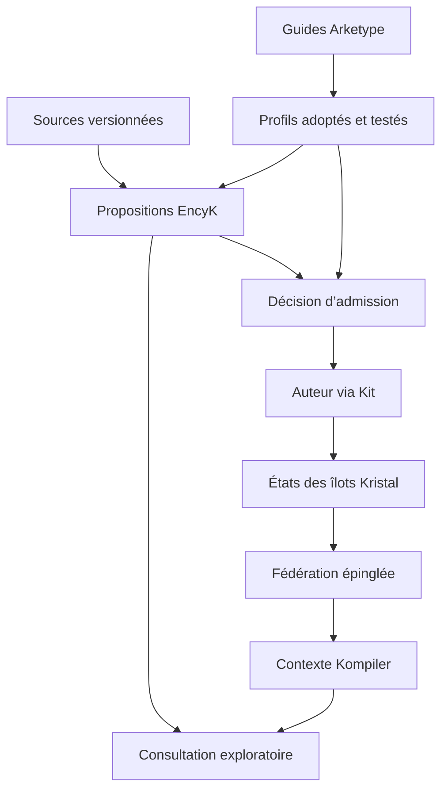

# EncyK : architecture décidée pour intégrer les îlots et préparer l’enrichissement massif

Rapport de décision destiné à l’IA de développement — 16 novembre 2026.

Ce document consolide et précise les recommandations précédentes. Il s’appuie sur les archives EncyK, Kristal-Framework, Authoring Kit, Integration Pack, Arketype, Manager, Kompiler, KristalDiag, LOT-K50 et Kristal-Wikidata-Workflow fournies dans cette conversation. Les décisions ci-dessous sont des recommandations d’architecture à mettre en œuvre ; elles ne décrivent pas des fonctions déjà réalisées. Les constats sont distingués des propositions. Aucun dépôt source, état canonique ni déploiement n’a été modifié pour produire ce rapport.

## 1. Décision centrale

**Construire un seul produit EncyK, avec un noyau opérationnel local et une fédération d’états Kristal. Conserver les îlots existants. Intégrer leur lecture immédiatement, puis leur enrichissement de manière progressive.**

Il faut unifier l’expérience et les contrats d’échange, sans fusionner arbitrairement tous les modèles de connaissance ni tous les dépôts. Une interface principale et une campagne commune peuvent piloter plusieurs composants spécialisés.

La question « un ou deux systèmes ? » cache trois décisions différentes :

| Dimension | Décision |
|---|---|
| Expérience utilisateur | Un point d’entrée EncyK, une navigation et un suivi de campagne cohérents |
| Autorité sur la connaissance | Les états Kristal portent le savoir admis ; chaque périmètre a un propriétaire explicite |
| Exécution et stockage | Plusieurs stockages possibles, avec des responsabilités distinctes et des références stables |

**Ne pas construire un canon encyclopédique EncyK qui recopierait et rééditerait indépendamment le canon des Kristals.** En revanche, conserver dans EncyK les propositions, décisions de sélection, tâches, coûts, index et vues nécessaires au travail. Ces données ne sont pas des doublons inutiles : elles ont un autre rôle.

Le bénéfice recherché est double : produire vite des informations sourcées utilisables et pouvoir transformer une partie de cette production en états durables, sans perdre les preuves ni réécrire l’ensemble.

## 2. Arbitrages fermes

| Question | Décision | Pourquoi |
|---|---|---|
| Archiver les 100+ Kristals pour repartir avec EncyK ? | Non | Leur contenu et leurs modèles sont des actifs ; une migration ne doit pas précéder toute utilisation |
| Conserver deux encyclopédies indépendantes ? | Non | Divergence des identités, corrections et enrichissements |
| Créer un nouveau format universel « îlot » ? | Non au départ | Le Framework prévoit déjà états, shards et fédération |
| Faire un Kristal par QID ? | Pas comme règle générale | Une entité de catalogue n’est pas nécessairement une unité d’auteur, de publication ou de stockage |
| Forcer chaque îlot dans une branche UNESCO ? | Non | Les domaines se recouvrent ; les rattachements sont multiples |
| Centraliser toutes les identités locales ? | Non | Respecter les namespaces ; maintenir des correspondances justifiées |
| Exploiter Arketype ? | Oui, comme aide structurante versionnée | Ses modèles ne sont pas des contrats normatifs ni des preuves de vérité |
| Tout faire passer par une revue humaine ? | Non | Contrôles automatiques déterministes et escalade ciblée, conformément à l’objectif de débit |
| Faire valider tout le patrimoine avant le premier résultat ? | Non | Capacités progressives : découverte, lecture, projection, écriture |
| Introduire immédiatement microservices et base graphe dédiée ? | Non | Les besoins et limites mesurés ne le justifient pas encore |
| Augmenter d’abord le nombre d’agents IA ? | Non | Qualifier l’admission, la reprise et le coût utile avant de multiplier les producteurs |

L’option retenue est donc une **fédération intégrée**, et non une fusion totale. C’est le meilleur compromis démontrable avec les informations disponibles ; une optimalité globale en performance ne peut pas être affirmée sans mesures sur la machine et les corpus réels.

## 3. Ce que les sources démontrent, et ce qu’elles ne démontrent pas

Le Framework décrit explicitement une composition sans copie du canon enfant, avec autorité indépendante et références immuables. Le parent porte notamment la topologie et le périmètre. Une modification de l’enfant ne modifie pas silencieusement un snapshot publié du parent.

Les contrôles du tour précédent ont trouvé des pins Kit–Pack identiques et 13 empreintes Framework concordantes. La vérification Pack sur l’exemple Framework et la qualification croisée Kit–Pack sur l’exemple ont réussi. Les échantillons réels Education et Soil ont passé la vérification v11 : respectivement 723 et 847 assertions. Cela prouve une validité structurelle et référentielle du périmètre contrôlé, pas une vérité scientifique.

Les crosswalks de ces deux échantillons contiennent zéro mapping. La conformité du graphe ne démontre donc pas son alignement Wikidata. Le lot K50 contient 50 noms de projets distincts ; les 72 fichiers workspace incluent des copies historiques. Il ne faut pas compter ces copies comme autant d’îlots.

Le workflow Wikidata présente des preuves réelles : 587 occurrences de fichiers d’entités, 583 QID distincts et 29 304 occurrences de statements dans la couche recomptée. Son dossier `04_Canonique_a_construire` annonce explicitement que le raccordement au canon reste à réaliser.

La lecture approfondie d’Arketype apporte une correction importante : il se déclare **bibliothèque de conception locale non normative**. Les recettes sont des propositions de composition. Son chemin externe draft.4 documenté crée un workspace vide et une indication de préparation, pas un domaine rempli ni une qualification sémantique. Les échecs de tests et ressources absentes mentionnés dans son README sont des résultats documentés du snapshot, pas une nouvelle exécution complète effectuée ici.

KristalDiag fourni cible v10. Sa réussite sur un profil supporté ne doit pas être utilisée comme preuve globale de conformité v11. Enfin, la documentation EncyK reste une source de conception et d’inventaire : elle ne permet pas de mesurer l’état actuel des bases volumineuses sur D: ni le comportement d’un déploiement vivant.

## 4. Modèle conceptuel : cinq objets à ne plus confondre

| Objet | Identité | Fonction |
|---|---|---|
| Sujet | Identifiant stable du catalogue ; liens externes éventuels | Ce dont on parle, indépendamment des branches et fichiers |
| Assertion contextualisée | Identité dans son espace d’auteur | Ce qui est affirmé, sous quelles conditions et avec quelles preuves |
| Îlot | Référence stable vers un périmètre de connaissance | Unité cohérente de lecture, d’auteur ou de gouvernance |
| État | Version ou engagement exact d’un îlot | Contenu précis utilisé à un moment donné |
| Branche | Code dans une taxonomie versionnée | Parcours de navigation et axe de couverture |

Un îlot peut contenir plusieurs sujets. Un sujet peut apparaître dans plusieurs îlots, avec des aspects différents. Un îlot peut être rattaché à plusieurs branches. Un état peut avoir plusieurs représentations physiques. Ces relations ne sont pas des exceptions : elles doivent être natives dans le modèle.

**Décision de granularité : créer un îlot pour une responsabilité cohérente, pas pour chaque ligne importée.** Un nouveau QID donne d’abord un sujet ou une correspondance candidate. Il devient un îlot autonome seulement s’il existe une raison de lui donner un cycle de vie, un modèle, un volume ou une autorité propres.

Les Kristals déjà organisés autour d’un sujet unique peuvent rester tels quels. La décision interdit d’en faire un automatisme universel, pas de conserver les unités existantes.

Les 88 branches recensées dans la documentation EncyK constituent un point de départ de navigation. Ce nombre n’est pas présenté ici comme une vérification indépendante d’une nomenclature UNESCO universelle. Il faut conserver la référence précise et la version de la source utilisée.

## 5. Source d’autorité et règle anti-duplication

L’expression « source unique de vérité » est trop imprécise pour ce système. Il faut une autorité identifiée **par catégorie de donnée et par périmètre**.

| Donnée | Autorité proposée | Copies permises |
|---|---|---|
| Contenu d’une source acquise | Dépôt de sources avec identité et révision | Cache identique, extrait référencé |
| Proposition extraite | Registre de propositions EncyK | Export de travail avec identifiant stable |
| Décision d’admission | Reçu de décision associé à la proposition et à sa politique | Index de statut |
| Contenu admis dans un îlot | État Kristal correspondant | Vue et index dérivés, sans écriture indépendante |
| Composition encyclopédique publiée | État parent avec enfants épinglés | Catalogue de consultation |
| Emplacement local d’un workspace | Inventaire local réutilisé via Manager selon son contrat | Résolution de chemin en cache |
| Coût et progression de campagne | Registre opérationnel EncyK | Tableau de bord |
| Suggestions Arketype | Bibliothèque de conception versionnée | Références et guidance attachées à un projet |

Une admission ne supprime pas la proposition initiale : celle-ci reste une trace historique avec un lien vers l’assertion ou l’artefact admis. L’interface évite de montrer les deux comme deux faits indépendants. Une correction ultérieure produit un nouvel état et une relation de remplacement, plutôt qu’une réécriture rétroactive de l’historique.

Les relations transversales doivent elles aussi avoir un propriétaire. Une relation interne appartient à son îlot. Une décision d’alignement appartient au crosswalk concerné. Une relation encyclopédique éditoriale entre îlots appartient au périmètre de composition qui l’a admise. Aucun graphe global ne doit absorber silencieusement l’autorité de ces trois catégories.

## 6. Préserver le débit : deux niveaux de connaissance consultables

La documentation EncyK privilégie le volume utile, les claims privés et deux passes IA. Ajouter une barrière d’admission lourde avant tout accès contredirait cet objectif.

**Décision : conserver un espace de travail consultable et un espace d’états admis.** Ce sont deux étapes d’un même parcours, pas deux encyclopédies indépendantes.

Dans l’espace de travail, EncyK peut exploiter une proposition avec sa source, son statut et ses limites. Dans une réponse destinée à s’appuyer uniquement sur des états admis, cette proposition est exclue. Dans une recherche exploratoire, elle peut apparaître explicitement comme provisoire. Ce choix doit être visible et inclus dans les paramètres du contexte compilé.

Les contrôles non négociables restent légers : identité traçable, source/révision identifiable, passage ou emplacement vérifiable, format valide, absence de doublon de traitement et respect des conditions requises du domaine. Il ne faut ni citation inventée ni conversion silencieuse d’une hypothèse en fait.

L’admission peut être automatique lorsqu’une politique bornée l’autorise et que les conditions sont satisfaites. Les conflits d’identité, modifications de périmètre et pertes de contexte requièrent une décision ciblée. Les assertions ordinaires n’exigent pas trois modèles réviseurs ni un clic humain systématique.

La publication externe demeure une action distincte. L’autorisation d’extraire et de travailler localement n’autorise pas implicitement toutes les publications futures.

Le schéma ci-dessous représente les responsabilités proposées. Une décision d’admission est nécessaire au passage vers l’auteur ; elle peut être automatique selon une politique bornée. Les deux chemins de consultation restent distingués.

## 7. Contrats minimaux à ajouter

Les noms de champs suivants sont une proposition logique, pas un schéma officiel Kristal. L’implémentation doit d’abord chercher leurs équivalents existants et réutiliser les contrats disponibles.

### Catalogue d’îlots

Conserver une référence stable, la nature du périmètre, l’autorité, le namespace, les branches associées, les modèles natifs déclarés et les capacités de lecture/écriture. Séparer la référence logique des chemins locaux. Séparer l’état courant de travail des états publiés connus.

Un catalogue dérivé peut être reconstruit depuis les inventaires. Les décisions éditoriales de rattachement et les alias manuels ne sont pas des caches : il faut leur donner un propriétaire et les sauvegarder.

### Proposition

Une proposition possède au minimum : identifiant, version, îlot cible ou cibles candidates, sujet/référents, contenu typé, conditions, référence source, emplacement, version du traitement, état source observé et statut. Conserver les qualificatifs de la source ; ne pas réduire toute proposition à sujet–prédicat–objet si le domaine nécessite davantage.

Une clé de réexécution doit distinguer acquisition, extraction générique et interprétation de domaine. Réutiliser l’article acquis entre branches ; réutiliser l’extraction quand le profil est identique ; autoriser une nouvelle interprétation si le modèle de domaine diffère. « Une extraction universelle définitive par article » perdrait des nuances.

### Décision et reçu d’admission

La décision consigne la proposition exacte, la politique et sa version, le résultat, les motifs et les preuves nécessaires. Le reçu relie cette décision à l’état précédent attendu, à l’artefact enregistré et au nouvel état effectivement observé. Les conditions d’un mapping exact prévues par le Framework restent applicables.

Ne pas exiger un gros manifeste manuel pour chaque sous-produit. Les identifiants et empreintes nécessaires sont produits automatiquement aux frontières où ils servent à la reprise, à l’identité ou à la reproductibilité. Ne jamais recalculer l’empreinte de tout un dump avant une simple requête indexée.

### Travail et coût

Chaque tâche a une clé d’idempotence, une phase, une tentative, une réservation de budget et un résultat. La réservation est distincte de la dépense observée. Une reprise ne libère pas par erreur le coût d’un appel fournisseur dont le résultat reste inconnu.

## 8. Intégration exacte d’Arketype

Arketype apporte un vocabulaire de formes, des exemples et des guides de périmètre. Son intégration doit respecter cette nature.

Trois étapes sont nécessaires :

1. sélectionner un modèle ou une composition et conserver sa référence ;
2. traduire les attentes utiles en règles de traitement et tests locaux explicites ;
3. adopter ces règles dans le profil d’auteur de l’îlot, avec une version et une responsabilité définies.

La première étape peut être suggérée automatiquement. Elle ne vaut pas les deux suivantes. Une détection par nom de fichier ne prouve ni l’adéquation au domaine ni la qualité des données.

Pour le pilote, retenir Education et Soil, dont des contenus réels ont été examinés, puis un troisième modèle natif différent tel qu’Accounting. Dans Education, vérifier que preuve et maîtrise ne sont pas fusionnées. Dans Soil, conserver les conditions d’observation. Pour Accounting, commencer par la lecture native et n’autoriser une écriture qu’après définition du contrat correspondant.

Un profil peut combiner plusieurs formes. Ne pas imposer un unique arketype exclusif par îlot et ne pas réécrire les données pour les faire ressembler à une illustration du catalogue.

## 9. Admission et reprise : résoudre le vrai point fragile

Le passage du registre EncyK aux artefacts du Kit traverse deux systèmes de persistance. Il faut un protocole de reprise, pas l’hypothèse d’une transaction globale.

Séquence recommandée :

1. enregistrer la proposition et la décision exacte ;
2. acquérir une exclusivité d’écriture sur le workspace cible ;
3. relire l’état et comparer à l’état attendu ;
4. préparer l’opération via un chemin d’auteur supporté ;
5. exécuter et obtenir un reçu lié aux artefacts réellement installés ;
6. réconcilier le statut EncyK ;
7. libérer l’écriture et planifier le rafraîchissement des dérivés.

Si l’état cible a changé, replanifier ou mettre en conflit. Ne pas appliquer aveuglément une proposition calculée sur une ancienne base. Une nouvelle décision peut réutiliser les preuves, sans imposer une nouvelle extraction coûteuse.

| Interruption | Comportement attendu |
|---|---|
| Avant l’opération d’auteur | Reprendre la tâche sans nouvelle admission |
| Après installation de l’artefact, avant index | Utiliser la récupération du Kit ; ne pas créer une seconde copie |
| Après index, avant reçu EncyK | Reconnaître l’opération accomplie et compléter le reçu |
| État modifié par un autre auteur | Suspendre cette admission et recalculer sa compatibilité |
| Reçu présent, vue absente | Réparer la projection, sans rejouer l’écriture canonique |

Le Kit documente un journal récupérable, mais pas une atomicité simultanée de tous les fichiers. Son verrou v11 n’est pas partagé par l’ancien `register-artifact`. L’orchestrateur doit donc garantir l’exclusion de ces écritures concurrentes ou refuser l’admission tant qu’il ne le peut pas.

L’idempotence concerne l’effet observé. Elle ne signifie pas que chaque appel externe ne s’exécute qu’une seule fois. Les délais réseau et interruptions peuvent produire un résultat inconnu qu’il faut réconcilier.

## 10. Réseau de connaissances : quatre couches, quatre sens

Le réseau doit rester interprétable. Ne pas mélanger les arêtes uniquement pour produire un graphe visuellement dense.

| Couche | Arêtes | Usage |
|---|---|---|
| Navigation | Branche–îlot, concept–sujet | Parcours et couverture |
| Identité | Alignements locaux/externes et leurs statuts | Réconciliation et jointures |
| Connaissance | Relations typées avec conditions et sources | Réponses et raisonnement borné |
| Suggestion | Similarité, voisinage, hypothèse de lien | Découverte et priorité de traitement |

Les artères utiles apparaissent lorsque des relations justifiées relient des domaines ou lorsque des usages récurrents traversent les mêmes concepts. La centralité peut suggérer des points de passage ; elle ne certifie ni la vérité d’un lien ni l’importance d’un domaine.

Décision pratique : démarrer avec des correspondances explicites et des relations déjà présentes. Ajouter les suggestions calculées dans une couche séparée. Ne pas comparer toutes les paires d’îlots et de concepts. Générer des candidats par index, QID communs, types et recherche bornée, puis examiner les liens plausibles.

Ne pas déduire une relation causale d’une proximité textuelle. Ne pas déduire une équivalence de la similarité d’un libellé. Les correspondances exactes doivent rester conformes aux décisions et preuves demandées par le Framework.

## 11. Lecture et Kompiler : produire un contexte fidèle

Le contexte compilé doit déclarer : états consultés, profil de sélection, langue, budget, statut des propositions incluses, couverture et omissions connues. Sa réduction ne doit pas transformer une absence du contexte en absence du savoir.

La synthèse narrative est une projection avec une provenance. Elle ne doit pas revenir comme nouvelle source indépendante dans une prochaine extraction. Même règle pour les réponses IA dérivées : conserver leur lignée et éviter les boucles d’auto-citation qui donnent une fausse impression de corroboration.

Pour un contexte d’îlot, sélectionner un noyau explicatif, les preuves pertinentes, les conditions et les contradictions matérielles. Préférer supprimer un élément entier avec indication d’omission plutôt que conserver une affirmation amputée de son qualificatif décisif.

Le Kompiler examiné génère la vue v11 avant de filtrer les identifiants et applique des limites locales de taille et de sélection. Le code ne démontre donc pas un coût de lecture proportionnel à la sélection finale. Les caches persistants ne sont pas à ajouter implicitement dans cet adaptateur : ils demandent un contrat de dérivation, d’invalidation et d’isolation explicite.

Décision : mesurer le chemin actuel, puis introduire une projection indexée ou une lecture sélective via un adaptateur qualifié. Clé de cache : états sources exacts, version du compilateur/profil, paramètres et périmètre d’accès. Un changement de droits ou de politique peut rendre un cache invalide même si le contenu source n’a pas changé.

## 12. Infrastructure choisie maintenant et conditions d’évolution

Conserver la direction du monolithe modulaire Python avec stockage de travail SQLite, interface principale locale et adaptateurs externes. Garder les corpus volumineux à leur emplacement et réutiliser leurs index. Skope et Kristalizer restent externes, sans copie ni fork.

Organiser les modules par responsabilités : catalogue, acquisition, extraction, propositions, admission, lecture et campagnes. Cela ne nécessite pas sept services réseau. Les workers peuvent être séparés lorsque la charge le demande, tout en gardant les mêmes contrats.

L’unité de concurrence doit suivre la ressource : lectures bornées sur corpus lourds, appels IA selon quotas, une écriture coordonnée par workspace. Dix conversations ou workers ne justifient pas dix scans simultanés d’un XML massif.

N’ajouter un stockage graphe spécialisé que si des requêtes représentatives restent trop lentes après indexation et optimisation du modèle. N’introduire une file distribuée que si plusieurs machines ou les exigences de disponibilité la rendent nécessaire. N’éclater un îlot que si son volume, son modèle ou sa gouvernance le justifie ; un segment physique n’est pas automatiquement un nouvel îlot.

Préparer l’échelle consiste aujourd’hui à éviter les traitements quadratiques, permettre la pagination, conserver des références stables, rendre les tâches reprenables et incrémentales. Cela ne consiste pas à déployer immédiatement une infrastructure hypothétique pour l’ensemble du Web.

## 13. Enrichissement massif : optimiser le gain utile

Un budget de 10 000 dollars n’a pas de rendement prévisible sans mesures locales. Les montants proposés précédemment étaient des enveloppes exploratoires, pas une estimation. Je retiens ici des portes de passage fondées sur les résultats, sans imposer arbitrairement un découpage monétaire.

Première campagne : sources structurées et corpus déjà présents, sur trois modèles de domaine. Reporter l’élargissement au Web général jusqu’à ce que provenance, reprise, identité et admission soient démontrées.

Le planificateur devrait favoriser une combinaison de manque identifié, utilité attendue, probabilité de nouveauté et coût marginal. Ce classement est une heuristique explicite, pas une probabilité de vérité. Réserver aussi une part de l’effort à des domaines moins documentés pour éviter qu’un algorithme guidé uniquement par les résultats faciles ne renforce les mêmes zones.

Mesurer séparément : acquisition réutilisée, propositions extraites, doublons, admissions, conflits, coût des reprises, coût des rejets et gain sur les réponses. Le coût par assertion seul encouragerait les assertions triviales. Le gain sur les réponses seul pourrait masquer l’absence de provenance. Les deux doivent être suivis.

Utiliser un jeu de questions fixe, incluant les cas défavorables : homonymes, négations, dates, mesures, désaccords, sources manquantes et contenus dépassés. Comparer avant/après sur les mêmes états et questions. Conserver un sous-ensemble non utilisé pour régler les prompts ; une IA qui se note elle-même sur ses exemples d’entraînement ne fournit pas une mesure indépendante suffisante.

Une source officielle ou réputée n’est pas une garantie globale. Le niveau de confiance doit rester lié au type d’assertion, à la fraîcheur, aux conditions et à la corroboration réelle. Des copies d’un même texte ou des synthèses issues d’une même origine ne comptent pas comme autant de preuves indépendantes.

## 14. Plan de réalisation ordonné

### Lot A — Catalogue et lecture unifiés

Créer l’adaptateur d’inventaire, dédupliquer les copies de workspace, séparer sujet/îlot/état/branche et lire des états existants. Préserver les références et l’historique. Résultat attendu : retrouver un îlot depuis plusieurs branches, ouvrir son contenu et afficher ses capacités sans le migrer.

Critère : Education et Soil lisibles ; troisième modèle natif reconnu avec ses limitations ; aucun nouveau canon parallèle ; absence de source externe expliquée sans crash général.

### Lot B — Collecte et propositions réutilisables

Raccorder les voies existantes Wikipédia/Wikidata et le protocole ZIP/retour. Garder les deux passes de sélection puis enrichissement. Stocker les propositions séparément du canon avec provenance et clés de reprise.

Critère : rejouer un lot ne double ni les propositions ni les appels déjà résolus ; un sujet multibranche réutilise l’acquisition ; une erreur locale ne détruit pas les items valides indépendants du lot.

### Lot C — Une admission complète sur Education, puis Soil

Définir l’adaptateur vers une opération Kit effectivement supportée, avec profils et reçus. Ne pas appeler une nouvelle fonction « import générique » sans contrat ni démonstration. Tester les interruptions et l’écriture concurrente.

Critère : une proposition justifiée produit un état valide ; sa reprise ne réadmet pas le même changement ; une proposition obsolète ne s’applique pas silencieusement ; le contenu source reste consultable.

### Lot D — Fédération et contexte reproductible

Épingler les enfants dans un snapshot de composition, compiler une réponse et gérer les vues dérivées. Le lecteur exploratoire peut suivre les états courants ; le lecteur d’un snapshot reste attaché à ses références.

Critère : après modification d’un enfant, le snapshot précédent restitue toujours son ancien périmètre ; un enfant manquant apparaît comme indisponible ; les affirmations provisoires sont identifiées ou exclues selon le mode.

### Lot E — Campagne mesurée et extension

Comparer charges, tailles de lots, coût utile et qualité sur les trois modèles. Augmenter progressivement volume et concurrence. Traiter les limites Kompiler observées avant de les masquer par une augmentation arbitraire des seuils.

Critère : pas de perte de provenance ou de duplication sur reprise ; coût réconcilié ; amélioration des réponses sans dégradation matérielle des cas critiques ; performances acceptables sur la machine cible. Les seuils numériques sont fixés avant la campagne de qualification à partir du pilote, pas ajustés après pour déclarer un succès.

## 15. Migration et archivage

Ne pas migrer en masse par numéro de version. Classer chaque îlot selon ses capacités et la valeur d’un enrichissement prévu. Prioriser les îlots actifs, réutilisés et compatibles avec un chemin d’auteur démontré.

Pour une migration : conserver l’état initial, documenter les transformations, comparer la couverture et les distinctions du domaine, puis adopter explicitement le nouvel état. Un même nombre d’assertions avant/après ne prouve pas l’absence de perte.

Archiver les anciennes interfaces et sorties de staging quand leur remplacement est utilisé et que les références nécessaires sont conservées. Ne pas archiver une dépendance partagée simplement parce qu’EncyK n’en affiche plus l’interface. Les duplications historiques peuvent rester hors index actif tout en étant disponibles pour audit.

La réversibilité porte sur les chemins de lecture, la possibilité de revenir à un état antérieur et la conservation des sources. Elle n’autorise pas à supprimer silencieusement un état déjà adopté par d’autres.

## 16. Points à ne pas construire maintenant

Reporter : un allocateur d’identité mondial, une fusion automatique de tous les namespaces, un nouvel ontologue universel, des microservices par composant, une réécriture des corpus existants, des graphes de similarité exhaustifs, une validation humaine de chaque ligne et une certification complète du patrimoine avant lecture.

Ne pas financer une grande ingestion pour compenser un défaut de modèle ou de raccordement. Ne pas financer non plus une infrastructure distribuée pour un problème qui provient d’une requête non indexée ou d’une vue reconstruite inutilement.

## 17. Instruction de réalisation à transmettre à l’IA

> Implémente EncyK comme un produit intégré sur une fédération Kristal. Commence par réutiliser les interfaces et contrats existants. Sépare sujet, îlot, état, branche et proposition. Maintiens la collecte privée à haut débit et rends explicite son statut provisoire. Les états admis restent dans Kristal ; les vues EncyK sont dérivées. Utilise Arketype comme guide de conception versionné, puis adopte des profils de traitement explicitement testés. Construis un adaptateur d’admission avec vérification d’état attendu, exclusivité d’écriture, reçu et reprise idempotente. Ne suppose pas qu’un QID implique un workspace, qu’un mapping candidat implique une identité exacte, ou qu’un contrôle technique implique la vérité. Conserve les sources, qualificatifs et contradictions. Épingle les enfants des snapshots publiés. Réalise les lots A à E dans cet ordre et fournis pour chacun une démonstration reproductible de ses critères. Ne migre pas tout le patrimoine et ne déclenche pas la campagne de dépenses avant cette qualification.

## 18. Références et portée

Pièces déterminantes, chemins relatifs dans les snapshots :

- EncyK : `docs/00_DEMARRAGE_IA/02_PRINCIPES_ET_COMPROMIS.md`, `docs/01_ECOSYSTEME/02_MATRICE_REEMPLOI.md`, `docs/06_MIGRATION_ET_VALIDATION/04_INCONNUES_MESURABLES.md`, `05_RISQUES_ET_DECISIONS.md`.
- Framework : `docs/03_CORE_INVARIANTS.md`, `docs/13_FEDERATION_SHARDS_AND_REFERENCES.md`, `spec/v11/Identity-and-Wikidata.md`.
- Authoring Kit : `docs/30_V11_TRANSACTION_RECOVERY.md`, contrats de pin, chemins de qualification et d’auteur.
- Arketype : `README.md`, `docs/17_BRANCH02_EXTERNAL_DRAFT4.md` ; ces textes précisent les frontières non normatives et les limites de qualification.
- Kompiler : `src/kompiler/adapters/kristal_v11.py`, notamment génération de vue avant sélection et limites locales.
- KristalDiag : cible et profils déclarés dans `README.md`.
- LOT-K50 : copies de staging des échantillons Education et Soil ; copies historiques distinguées de projets uniques.
- Workflow Wikidata : preuves des seize Kristals et `04_Canonique_a_construire/README.md`.

Ce tour a approfondi la lecture des contrats et du code ciblé, confronté les recommandations aux arbitrages EncyK et produit les décisions ci-dessus. Il n’a pas exécuté un pilote d’admission, un benchmark des bases D:, ni une qualification complète des dépôts. Les contrôles techniques positifs cités proviennent des vérifications réalisées précédemment dans cette même analyse et restent limités à leurs échantillons.

**Décision finale : préserver les îlots, unifier le produit, fédérer les états, accélérer les propositions et fiabiliser leur admission. Le prochain investissement doit fermer cette boucle avant d’amplifier le volume d’IA.**
