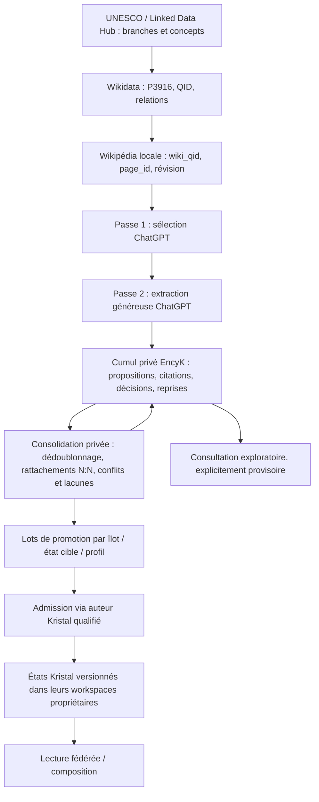

# V32.2 — Décision de workflow : cumuler dans EncyK, intégrer ensuite dans Kristal

**Décision de conception, 16 novembre 2026.** Cette page est normative pour le **workflow cible** du manager EncyK, mais ne prétend pas que l'admission Kristal est implémentée. Elle complète la [construction à deux passes](03_PIPELINE_IA_PROPOSITIONS.md), l'[admission via Kit](04_ADMISSION_KIT_REPRISE.md) et les [lots de réalisation](07_LOTS_A_E.md).

## 1. Décision courte

**Le moteur de construction n'écrit pas les états Kristal à chaque retour ChatGPT.** Il continue à produire **massivement** dans le registre privé EncyK, en cumulant des propositions sourcées et des décisions de pertinence pour les 87 branches restantes. À la clôture **d'une campagne, d'une branche ou d'une vague exploitable**, un traitement distinct prépare et fait admettre les propositions admissibles dans les **îlots Kristal existants**, notamment ceux préparés dans `UNESCO_Kristals`, **uniquement via l'Authoring Kit qualifié**.

Cela donne un **flux différé et incrémental**, et non un grand transfert unique obligatoire après les 87 branches. On peut continuer à produire pour d'autres branches pendant qu'un lot mature est promu. La clôture d'un lot n'exige ni exhaustivité de Wikipédia ni disparition de tous les HOLD.

## 2. Flux de bout en bout

Le passage `R → X → B → A` est **différé** : il ne bloque ni la création d'un autre pack, ni l'import d'un retour, ni l'ouverture d'une nouvelle branche. **Aucune action dans le flux ne transforme implicitement un SELECT en APPROVE canonique.**

## 3. Les phases, propriétaires et sorties

| Phase | Ce qui est fait | Autorité | Sortie |
|---|---|---|---|
| **0 — Découverte locale** | UNESCO → P3916/Wikidata → `wiki_qid`/Wikipédia, voisinage sélectif et fallback | Index de référence en lecture seule | Candidats et routes traçables |
| **1 — Sélection** | ChatGPT juge article–sujet–concept ; `SELECT / REJECT / HOLD` | Registre de décisions EncyK | Couples pertinents, non canoniques |
| **2 — Extraction intensive** | Lecture des articles retenus, faits spécifiques, citations, conditions, contradictions | Registre privé EncyK | Propositions en `DRAFT`, `UNASSIGNED`, corrections, couvertures |
| **3 — Cumul et préparation** | Déduplication interbranches, rapprochement avec les îlots, profils, versions, répartition des anomalies | EncyK : données de travail et décisions | Vues de campagne et **lots de promotion proposés** |
| **4 — Promotion différée** | Admission des propositions éligibles via l'auteur du workspace, état attendu et reçu | **Kristal / Authoring Kit** | Nouvel état Kristal effectivement observé |
| **5 — Fédération/consultation** | Composer les états admis ; distinguer consultation exploratoire et admise | États Kristal pour le contenu admis | Vues/projections dérivées |

**Important :** les phases 0–2 et l'import privé existent partiellement dans le code V32.2. **La phase 3 est une cible d'orchestration**, non un export de promotion qualifié aujourd'hui. **Les phases 4–5 ne sont pas complètement opérationnelles** : `encyk_v32.federation.admit_proposals()` lève volontairement une erreur; `export_federated_read_view()` produit une vue de métadonnées, pas un état parent Kristal publié.

## 4. Où s'accumulent les données

Le stockage de travail V32.2 conserve déjà notamment : `candidates`, `decisions`, `decision_history`, `jobs`, `source_results`, `proposals`, `proposal_concepts`, `proposal_citations`, `proposal_occurrences`, `proposal_replacements`, `receipts` et `import_errors`.

- **Une proposition = une affirmation contextualisée**, non une ligne de canon. Son `proposal_id` reste stable dans les retours et corrections.
- **Un sujet** est identifié au mieux par son QID, mais le QID n'implique pas un workspace Kristal.
- **Un concept UNESCO / une branche** organise la pertinence documentaire. Une proposition peut alimenter plusieurs concepts; une admission ne doit pas recopier physiquement le même fait dans 87 états sans motif d'autorité.
- **Un îlot Kristal** est une unité d'auteur et de gouvernance. Un îlot peut couvrir plusieurs sujets; un sujet peut être documenté dans plusieurs îlots selon les modèles natifs.
- **La preuve** est liée à la source/révision et au passage; les qualificatifs et contradictions restent associés à la proposition.
- **La consultation exploratoire** peut utiliser le registre privé en affichant son statut. La consultation « admise seulement » ne transforme jamais cette projection en source canonique.

Les clés de réemploi ne doivent pas perdre le contexte du domaine : une page Wikipédia acquise une seule fois peut nécessiter plusieurs **interprétations** si les profils sont réellement différents. Une proposition corrigée reste reliée à son antécédent.

## 5. Quand lancer une promotion ?

**Pas au retour de chaque ZIP ; pas nécessairement après l'ensemble des 87 branches.** Déclencher un lot quand une campagne ou une branche a produit une quantité utile et stable de propositions, que les sources sont localisables, qu'un ou plusieurs îlots cibles ont été identifiés et qu'un chemin d'auteur supporté existe pour leur modèle.

Les indicateurs de préparation sont : propositions distinctes sourcées, taux d'assignation à un sujet/concept/îlot, conflits d'identité ou conditions manquantes, reprise des retours partiels, nouveautés par article et disponibilité d'un profil d'admission. Ce sont **des indicateurs opérationnels**, pas un pourcentage arbitraire de Wikipédia ou un seuil universel de claims.

La production peut rester ouverte après une promotion. Une seconde vague créera un **nouvel état** Kristal, sans réécrire rétroactivement le précédent. Un lot sans auteur admissible reste en attente, mais ses propositions privées demeurent consultables et la production continue.

## 6. Comment préparer un lot de promotion

**Contrat cible à implémenter (pas une signature d'API déjà existante).** Regrouper les propositions éligibles par :

1. `target_island` / namespace et source de l'alignement ;
2. modèle/profil du domaine et version ;
3. état Kristal de départ attendu ;
4. provenance, sujet, concept(s) UNESCO et branche(s) ;
5. décisions de politique et conflits non résolus ;
6. identifiants de propositions, sources et passages ;
7. résultat/reçu d'admission une fois l'opération réellement faite.

Le **rattachement concept → QID** ne suffit jamais à attribuer automatiquement une proposition à un îlot. Respecter les mappings ambigus, les sujets partagés entre branches et les modèles de domaine natifs. Si aucun îlot préparé n'est un propriétaire adéquat, laisser la proposition dans EncyK; **ne pas forcer un workspace ni une branche**. Créer un nouvel îlot est une décision de périmètre séparée.

Les dossiers `UNESCO_Kristals/branches/*/build/v9` présents dans le dépôt vivant contiennent **440 artefacts supplémentaires sur 88 branches** par rapport à la copie V32.2. Il faut les préserver et les lire par une interface qualifiée. Ce sont des **états ou sorties de construction**, pas automatiquement des points d'écriture : **ne pas modifier leurs fichiers à la main** et ne pas supposer que le moteur V32 les connaît déjà.

## 7. Exécution d'une promotion et reprise

Une fois les API réelles Framework/Kit vérifiées, l'ordonnanceur pourra : enregistrer un lot proposé → décider son admission selon un profil borné → verrouiller le workspace cible → comparer l'état attendu → utiliser une opération d'auteur supportée → observer le nouvel état → enregistrer le reçu → rafraîchir les vues.

- Si l'état a changé, suspendre ou replanifier **sans perdre le cumul EncyK**.
- Si un retour d'opération est inconnu, réconcilier l'effet observé avant une relance.
- Si seule la projection manque, réparer la vue sans réécrire Kristal.
- La même proposition ne doit pas être admise deux fois comme deux écritures indépendantes, et plusieurs citations d'une source ne doivent pas compter comme preuves indépendantes.
- Les contrôles doivent être **automatisés et légers** : identité, source/révision, passage, contrat du domaine et cohérence de l'état attendu; pas de triple revue systématique ni de recalcul des empreintes des dumps massifs.

## 8. Moteur ChatGPT : priorité au rendement documentaire

Les packs de sélection restent **assez larges pour ne pas exclure un article qui traite substantiellement le concept**. Les packs d'enrichissement doivent demander **beaucoup de faits distinctifs**, couvrant les sections et détails utiles du texte réellement fourni, avec des citations localisables; les retours partiels restent réparables. Ne pas fixer artificiellement une durée de réponse ni une quantité identique pour tous les articles. La bonne mesure est le **rendement utile sourcé** (nouveaux faits spécifiques, couverture des sections, doublons, reprises), pas la longueur verbale.

Conserver des missions suffisamment riches pour occuper efficacement les dix postes; dimensionner les packs sur la capacité observée, non sur un quota volontairement petit. La promotion ne doit **jamais** se glisser dans le prompt de la passe 2 : ChatGPT propose, le manager cumule, un auteur Kristal qualifié admet plus tard.

## 9. Première branche et limites de périmètre

La production historique `unesco.mt1.10` peut être archivée hors du circuit V32.2; **son archivage n'implique pas l'archivage des index Wikipédia, Wikidata, du catalogue de référence, ni des 88 états UNESCO**. Les index D: restent en place. La copie Médiathèque C:, Skope et Kristalizer ne sont ni modifiés ni déplacés.

## 10. Critères de validation avant toute prétention de « workflow final »

- Le cumul privé fonctionne sur deux branches ayant un article/QID commun, sans duplication physique de l'acquisition ou des faits identiques.
- Un lot partiel ou corrigé est repris avec ses citations et sans perdre de propositions.
- Une campagne peut être marquée **prête pour promotion** sans fermer les autres branches.
- Une promotion de test est démontrée dans une **copie de workspace** Education, puis Soil, avec un auteur Kit supporté; on vérifie refus de version périmée, reçu et récupération après panne.
- Les états et artefacts `build/v9` du dépôt UNESCO vivant demeurent intacts jusqu'à leur qualification d'accès; la fédération respecte leur autorité.
- Le manager différencie le nombre **proposé**, **prêt à admettre**, **réellement admis** et **resté en attente**. Une campagne riche en propositions n'est pas faussement annoncée comme publiée dans les Kristals.

### Résumé pour l'agent de développement

> **La boucle principale EncyK est `découvrir → sélectionner → enrichir → cumuler`, répétée massivement. La boucle secondaire est `consolider → proposer l'admission → écrire via Kit qualifié → fédérer`, par lots différés. Ne pas relier une écriture Kristal à l'import d'un ZIP. Ne pas attendre 87 branches avant la première qualification de l'Authoring Kit : tester tôt une admission sur copie, puis promouvoir en production seulement les lots mûrs.**
